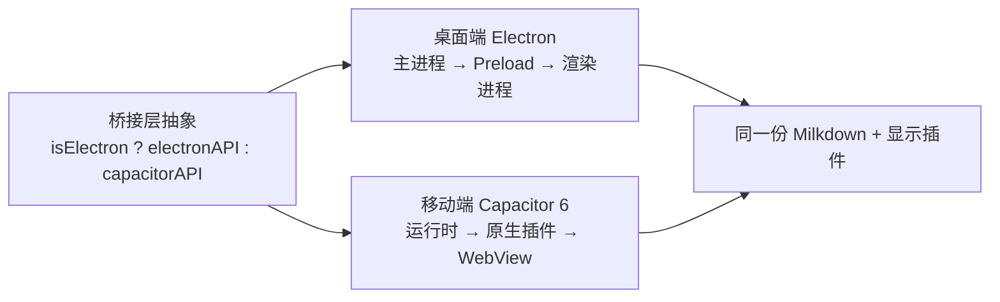

<!-- deck
brand: ColaMD-extend
title: 面向 Agent Native 的声明式显示系统
meta: 学术汇报 · 2026.05
-->

<!-- slide: cover
kicker: 学术汇报
-->

# ColaMD 扩展版

## 面向 Agent Native 场景的声明式显示系统

ByteUser1977 · ColaMD 扩展开发团队 · 2026.05

KaTeX + Mermaid 双引擎 · 双模式编辑 · Electron + Capacitor 双平台

---

<!-- slide: agenda
kicker: Contents
label: 议程
chapter: 目录
-->

## 议程

1. 研究背景与问题
2. 系统架构
3. 数学与图表插件
4. 跨平台与主题
5. 实验与结论

---

<!-- slide: section
kicker: Act I
label: 研究背景
chapter: Act I · 背景
-->

## 研究背景与问题

Agent 负责写，人负责看；编辑器要跟上这个节奏。

---

## Agent Native 的信息鸿沟

Agent 已经把 Markdown 当作主要交付格式，但编辑器还停留在“手动刷新”的时代。

- **写入** Agent 自动生成、修改 `.md` 文件
- **感知** 人类需要刷新或重载才能看到变化
- **代价** 频繁上下文切换抵消了自动化收益

ColaMD 用 `fs.watch` 与标题栏呼吸灯把这条链路接上；扩展版要解决的是“接上之后，内容够不够表达”。

---

<!-- slide: quote
kicker: Concept
label: Markdown as Database
chapter: Act I · 理念
-->

> 把 `.md` 当作不可变的内容层，幻灯片、博客、简历只是不同视图。

Markdown as Database

---

<!-- slide: steps
kicker: Questions
label: 三个关键问题
chapter: Act I · 问题
-->

## 三个关键问题

1. **富内容表达** 如何在保持 Agent Native 的前提下支持公式与图表？
2. **插件架构** 如何让不同渲染引擎一致地注册、启停与切换？
3. **跨平台复用** 如何用最小代价把桌面能力带到移动端？

---

<!-- slide: matrix
kicker: Contributions
label: 本文贡献
chapter: Act I · 贡献
-->

## 本文贡献

- **声明式插件架构** Schema + NodeView + Remark + 序列化的统一流水线
- **KaTeX + Mermaid 双引擎** 行内/块级公式与 17 种图表
- **双模式切换** 渲染模式与源码模式，失焦自动保存
- **双平台桥接层** Electron 与 Capacitor 6 共享同一套 API

---

<!-- slide: section
kicker: Act II
label: 系统架构
chapter: Act II · 架构
-->

## 系统架构

两套运行栈，一套渲染代码。

---

<!-- slide: figure
kicker: Architecture
label: 双平台分层架构
chapter: Act II · 架构
-->

## 双平台分层架构

同一份 Web 渲染代码，通过自动检测的桥接层落到 Electron 或 Capacitor。

---

<!-- slide: figure
kicker: Pipeline
label: 插件渲染流水线
chapter: Act II · 插件
-->

## 显示插件渲染流水线

每个插件都走同一条声明式流水线，注册后自动出现在 Plug 菜单。

---

<!-- slide: two-col
kicker: Mode
label: 双模式切换
chapter: Act II · 编辑
-->

## 双模式切换

渲染模式与源码模式共享同一份内容，切换不丢状态。

### 渲染模式

- KaTeX / Mermaid 实时渲染
- 富文本展示，适合阅读与演示
- 右键可导出 2× PNG

## 源码模式

- 公式与图表以源码编辑
- 失焦自动保存并重渲染
- 一键切换，互不影响

---

<!-- slide: matrix
kicker: Contrast
label: 与原生版对比
chapter: Act II · 对比
-->

## 扩展版带来了什么

原版能力完整保留；增量集中在表达、插件、编辑与移动端。

- **内容** 从纯文本到 Markdown + 公式 + Mermaid
- **插件** 从无到声明式注册、独立启停
- **编辑** 从单一视图到渲染 / 源码双模式
- **移动** 从桌面独占到 Android + iOS 双端

---

<!-- slide: section
kicker: Act III
label: 数学与图表
chapter: Act III · 富内容
-->

## 数学与图表

两种富内容，一套插件范式。

---

<!-- slide: kpi
kicker: Math
label: 为什么选 KaTeX
chapter: Act III · 公式
-->

## 为什么选 KaTeX

渲染速度、体积与导出质量是三个硬指标。

- **1/10** 平均渲染耗时，约为 MathJax 的十分之一
- **1/3** 核心库体积，对移动端加载更友好
- **2×** PNG 导出，满足出版级清晰度

---

## 公式插件的四个关键点

两种输入形态，两个实现细节。

| 关键点 | 说明 |
| --- | --- |
| 行内公式 | `$...$` 走 `katex.renderToString`，嵌入文本流 |
| 块级公式 | `$$...$$` 居中显示，保留上下文间距 |
| 失焦保存 | 源码模式改完即存，自动重渲染 |
| 容错与导出 | 语法错误红字提示；SVG → Canvas 输出 2× PNG |

四个点合起来，就是“能输入、能编辑、能容错、能导出”。

---

<!-- slide: matrix
kicker: Math
label: Math 插件配置
chapter: Act III · 公式
-->

## Math 插件配置

- **标识符** `math`，插件管理器中的唯一 ID
- **默认启用** `true`，首次加载自动激活
- **右键菜单** Save Equation as PNG，2× 分辨率
- **节点类型** `math_inline` / `math_block`，对应行内与块级

---

<!-- slide: matrix
kicker: Mermaid
label: 17 种图表
chapter: Act III · 图表
-->

## 一套语法，覆盖 17 种图表

- **流程与交互** `flowchart` / `sequenceDiagram` / `stateDiagram`
- **结构与数据** `classDiagram` / `erDiagram` / `sankey-beta`
- **规划与管理** `gantt` / `timeline` / `journey`
- **分析与决策** `quadrantChart` / `xyChart` / `pie`
- **知识与版本** `mindmap` / `gitGraph`
- **架构与框图** `C4` / `block-beta` / `architecture-beta`

---

<!-- slide: two-col
kicker: Mermaid
label: 渲染细节
chapter: Act III · 图表
-->

## 渲染安全与主题适配

Mermaid 是异步的，细节决定图表在编辑器里稳不稳。

### 渲染安全

- 输入 Mermaid 代码围栏，自动转成图表节点
- 渲染计数器避免竞态，只写回最后一次结果
- `getBBox()` 量实际高度，容器 +6px 自适应
- 四阶段 PNG 流水线，2× 缩放

## 主题适配

- 每个 UI 主题一套 Mermaid 配色
- Light / Dark / Elegant / Newsprint / Forest Ink
- 导入主题同样走 CSS 变量

---

<!-- slide: section
kicker: Act IV
label: 跨平台与主题
chapter: Act IV · 平台
-->

## 跨平台与主题

桌面、移动、主题，三件事共用一套契约。

---

<!-- slide: two-col
kicker: Platform
label: 双平台桥接
chapter: Act IV · 跨平台
-->

## 同一套 API，两套运行栈

桥接层只做一件事：把 `electronAPI` 与 `capacitorAPI` 收敛成同一个接口。

### 桌面端 Electron

- 主进程：窗口、文件 I/O、`fs.watch`
- Preload：`contextBridge` 暴露安全 API
- 渲染进程：Milkdown + 显示插件

## 移动端 Capacitor 6

- Android WebView / iOS WKWebView
- Filesystem / FilePicker / Share / App / StatusBar / Haptics
- Web 渲染层与桌面端完全共享

---

<!-- slide: matrix
kicker: Mobile
label: 移动端能力
chapter: Act IV · 移动
-->

## 移动端能力矩阵

- **完整支持** Markdown、KaTeX、Mermaid、插件、主题、HTML 导出
- **部分支持** CJK 输入、PDF 导出、Agent 轮询、幻灯片预览
- **输入法** 已做焦点与 `inputType` 优化，仍有边缘情况
- **文件监听** 2 秒轮询替代 `fs.watch`，延迟约 +1s
- **导出** `window.print()` 模拟 PDF，能力受限
- **幻灯片** 基础可用，完整功能留在桌面端

---

<!-- slide: matrix
kicker: Theme
label: 主题系统
chapter: Act IV · 主题
-->

## 四套内置主题，一套显示契约

显示插件全部走 CSS 变量，换主题即换整套富内容的皮；`~/.colamd/themes/` 支持导入自定义主题。

- **Light** 白色背景、深色文字，系统无衬线体
- **Dark** `#0d1117` 背景、浅色文字
- **Elegant** 暖色背景、霞鹜文楷，默认主题
- **Newsprint** 米黄背景、PT Serif，印刷质感

---

<!-- slide: steps
kicker: SVG
label: 内联 SVG 规范
chapter: Act IV · SVG
-->

## 内联 SVG 的六条硬规则

空行是段落分隔符，跨空行的 SVG 一定被拆碎。

1. **单行压缩** `
` 块内不能有换行
2. **标签闭包** 所有标签正确闭合或自闭合
3. **命名空间** 声明 `xmlns`
4. **视口一致** `width` / `height` 与 `viewBox` 匹配
5. **属性引号** 属性值统一双引号
6. **字符编码** 用 `-` 替代箭头等非 ASCII 符号

---

<!-- slide: section
kicker: Act V
label: 实验与结论
chapter: Act V · 验证
-->

## 实验与结论

数据、边界，以及下一步。

---

<!-- slide: kpi
kicker: Evaluation
label: 实验与关键数字
chapter: Act V · 实验
-->

## 实验环境与关键数字

桌面端 macOS / M3 Pro / Electron 34；移动端 Android 14 / Snapdragon 8 Gen 3 / Capacitor 6.2.1。

- **< 210 ms** 所有测量操作的最慢耗时
- **12 / 28 ms** 行内公式，桌面 / 移动
- **85 / 156 ms** Mermaid 流程图，桌面 / 移动
- **+16.4%** 内存增量，主要来自双引擎运行时

---

<!-- slide: matrix
kicker: Evaluation
label: 性能明细
chapter: Act V · 实验
-->

## 性能明细

桌面 / 移动，单位 ms；所有操作都在 300 ms 的可接受线内。

- **块级公式** 18 / 35
- **时序图** 62 / 118
- **模式切换** 8 / 12
- **公式 PNG** 45 / 82
- **图表 PNG** 120 / 210
- **内存** 156 / 89 MB

---

<!-- slide: two-col
kicker: Outlook
label: 局限与未来
chapter: Act V · 讨论
-->

## 局限与未来

系统已经可用，但边界仍然清楚。

### 当前局限

- 移动端 IME：第三方输入法仍有候选词与组合输入问题
- Agent 监听：移动端退化为 2 秒轮询，延迟 +1s
- 内联 SVG：单行压缩可读性差，diff 不友好

## 下一步

- 插件生态：代码高亮增强、可视化公式编辑器
- 双向同步：编辑器修改写回磁盘
- 多文件会话：同时监听多个 `.md`
- 移动端 IME：探索原生输入框代理

---

## 结论

ColaMD 扩展版把“能写”推进到“能表达”：

- **插件化** 声明式流水线，公式与图表可插拔、可独立启停
- **双模式** 渲染与源码共享同一份内容，阅读与编辑各得其所
- **双平台** 同一套 Web 渲染代码，Electron 与 Capacitor 复用
- **可验证** 最慢操作 < 210 ms，2× PNG 达到出版级清晰度

对 Agent Native 场景而言，编辑器不只是显示容器，而是人机协作的最后一公里。

---

## 参考文献

1. ColaMD: Markdown as Database — Agent Native Editor.
2. ColaMD-extend: Display Plugin System for ColaMD.
3. KaTeX: The Fastest Math Typesetting Library for the Web.
4. Mermaid: Diagramming and Charting Tool.
5. Electron: Build Cross-Platform Desktop Apps with JavaScript.
6. Capacitor: Cross-Platform Native Runtime for Web Apps.
7. Milkdown: WYSIWYG Markdown Editor Framework.
8. GB/T 7713—201X 科学技术报告、学位论文和学术论文的编写格式.

完整 12 条见论文原文。

---

<!-- slide: closing
kicker: Q&A
label: 讨论
chapter: 讨论
-->

# 谢谢

欢迎讨论与指正

ColaMD-extend · 2026.05
