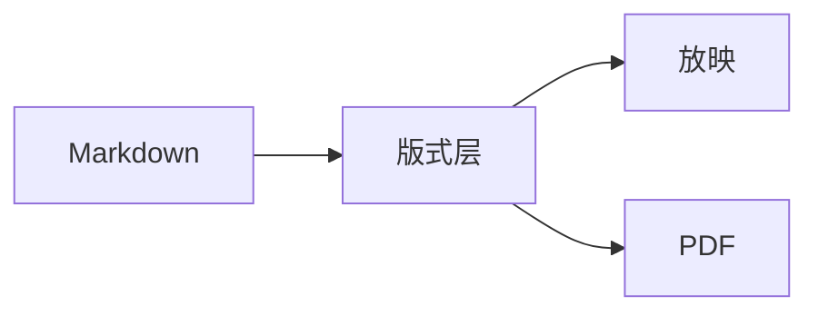

# Markdown PPT 配置说明

这份文档只讲「怎么写」。实现背景、版本取舍见 [release-2.7.13-rc.2.md](release-2.7.13-rc.2.md)；可直接套用的骨架在 [resources/templates/slides.md](../resources/templates/slides.md)，完整示例在 [resources/demo/slides-demo.md](../resources/demo/slides-demo.md)。

## 最小可用稿

````markdown
<!-- deck
title: 一次内部汇报
brand: 团队名
-->

<!-- slide: cover -->
# 一次内部汇报
## 副标题
一句导语

---

<!-- slide: kpi -->
## 核心数据
- **42%** 转化率
- **1.8 万** 月活
````

`---` 分页，第一页第一块是 `slide` 页头，标题后的第一段自动成为导语。没写 `slide` 的页走默认文章版式。

## 页头块

### deck 块

放在文档最顶部，整个文档建议只写一块，字段都可省略：

| 字段 | 作用 | 默认 |
| --- | --- | --- |
| `logo` | 顶栏左侧 logo。相对路径按当前 Markdown 所在目录解析，也接受 URL / data URI | 不显示 |
| `brand` | 页脚左侧品牌字 | 不显示 |
| `title` | 顶栏左侧文案，也是每页 `label` 的兜底 | 不显示 |
| `meta` | 顶栏右侧文案，也是每页 `chapter` 的兜底 | 不显示 |

```markdown
<!-- deck
logo: ./assets/logo.png
brand: ColaMD-extend
title: ColaMD-extend 项目调研
meta: 2026.05 · 投研
-->
```

### slide 块

放在每页开头。可以写成单行 `<!-- slide: kpi -->`，也可以写成块：

```markdown
<!-- slide: kpi
kicker: Executive Summary
label: 核心数据速览
chapter: Act I · 集团全景
-->
```

| 字段 | 作用 | 默认 |
| --- | --- | --- |
| `slide` | 版式名，见下方清单 | 默认文章版式 |
| `kicker` | 标题上方的小字 | 取本页标题前第一个段落 |
| `label` | 顶栏左侧短标签 | `deck.title` |
| `chapter` | 顶栏右侧章节文案 | `deck.meta` |

同一页建议只写一块；重复字段以后写的为准。字段顺序任意。

## 页面结构与自动识别

每页按下面的顺序识别，不需要额外标记：

1. **页标题**：本页第一个标题（`#`、`##`、`###` 都行）自动成为页标题，统一按内容页标题字号排版。
2. **导语**：标题后第一个段落自动成为导语。
3. **kicker 兜底**：没写 `kicker` 时，标题前第一个段落会当作 kicker。这段源码在放映和导出时隐藏，只保留标题行上的小字。
4. **chapter / label 兜底**：没写就用 `deck.meta` / `deck.title`。

分页与分隔线：

- `---` 是标准分页符。
- `***`、`___` 也是 Markdown 分隔线，同样会分页；`***` 常用来做「会动的章节条」那一页的可见横线，但它已经是分页符，**后面不要再跟一个 `---`**，否则会多出一张空白页。
- 只有空行/分隔线的页会被自动过滤，不算页数。

## 版式清单

| 版式 | 内容约定 |
| --- | --- |
| `cover` | 封面：`#` 主标题、`##` 副标题、首段导语；顶栏保留 logo 与报告名 |
| `section` | 章节页：标题 + 可选导语，垂直居中 |
| `agenda` | 议程：有序列表，建议 3–5 项 |
| `kpi` | 关键数字：无序列表，每项 `- **数值** 说明`，建议 3–4 项 |
| `timeline` | 时间轴：列表一项一个节点，建议 `- **时间** 事件` |
| `steps` | 步骤：有序列表，一项一步 |
| `matrix` | 卡片矩阵：无序列表，每项 `- **标题** 说明`，建议 3–6 项 |
| `two-col` | 双栏：整页内容自动分两栏，建议两组 `###` 小标题 |
| `figure` | 图表页：标题 + 可选导语 + Mermaid / SVG / 图片，图约占画面七成 |
| `quote` | 引言：一段引用 `> …`，引用后一行普通文字可作署名 |
| `closing` | 收束页：`#` 标题 + 可选一段话 |

### 封面

```markdown
<!-- slide: cover
kicker: 公司深度调研
-->

# ColaMD-extend
## 下一阶段的业务升级
一句导语，自动按导语排版
```

### 关键数字

```markdown
<!-- slide: kpi
kicker: Executive Summary
chapter: Act I · 集团全景
-->

## 核心数据速览
决策者 1 分钟速览

- **42%** 转化率
- **1.8 万** 月活
- **12%** 研发投入占比
```

### 图表页

````markdown
<!-- slide: figure
kicker: Diagram
label: 图表独立页
chapter: Act I · 图表
-->

## 图表独立页

Mermaid、SVG 与普通图片都走这一版式，图占画面约七成并居中。


````

图片用普通 Markdown 即可：

```markdown

```

图表和图片都按正文宽度的 70% 居中显示；放映最高 66vh，导出最高 52vh。标题与普通内容页同档，不再缩成小注。

### 引言

```markdown
<!-- slide: quote -->

> 版式不是装饰，是信息密度的边界。

—— 项目组
```

## 默认文章页

不写 `slide` 块的页自动走文章版式：

- 页标题 3.4em，正文 0.95em / 行高 1.8，行宽 82%；
- 导出时再压到 3em / 0.9em / 1.7，尽量一页读完；
- 适合一页多个段落、列表混排的长文；超过三四段建议主动分页，而不是继续缩字号。

```markdown
---

## 默认页：把一页写满

这是没有写 slide 块的默认页：标题收小、行距放宽、行宽收窄，一页能装下更多段落。

- **先给结论** 第一段就让读者知道这页要说什么。
- **再拆关系** 并列项用列表，因果链用步骤或时间轴。
- **最后收口** 一页只留一个判断，下一页再展开。
```

## 页内样式与脚本

需要单页微调时，可以在页内加 `slide-css` 块，样式只作用于本页：

```markdown
<!-- slide-css
.cm-md-hr {
  display: block;
  width: calc(var(--demo, 0) * 1%);
  height: 4px;
  background: var(--pele-accent);
}
-->
```

需要动画时用 `slide-js`，脚本跑在沙箱 iframe 里，只能通过 `slide.setVar` / `slide.setClass` / `slide.setTimeout` / `slide.requestAnimationFrame` 影响页面，离场自动回收：

```markdown
<!-- slide-js
[15, 40, 70, 100].forEach(function (w, i) {
  slide.setTimeout(function () {
    slide.setVar('demo', String(w))
  }, 700 * (i + 1))
})
-->
```

`slide-css` 会拒绝绝对定位与伪协议；日常排版优先用版式与主题令牌，不要用页内脚本硬改结构。

## 自定义主题里的 PPT 样式

`slides.css` 在导入的主题 CSS 之前加载。自定义主题（`body.theme-custom`）可以直接覆盖 `--slide-*` 令牌：

```css
body.theme-custom {
  --slide-title-font: 'Songti SC', serif;
  --slide-title-size: 4em;
  --slide-cover-title-size: 5.6em;
  --slide-kicker-tracking: 0.2em;
  --slide-chrome-opacity: 0.55;
  --slide-page-top-pad: 64px;
}
```

常用令牌：

| 令牌 | 作用 |
| --- | --- |
| `--slide-title-font` | 页标题、封面/章节大标题的字体族 |
| `--slide-title-size` | 内容页标题字号（默认 4.2em） |
| `--slide-title-weight` / `--slide-subhead-weight` | 标题 / 小标题字重 |
| `--slide-cover-title-size` | 封面主标题字号（默认 6.8em） |
| `--slide-section-title-size` | 章节页标题字号（默认 5.2em） |
| `--slide-lead-size` | 导语字号（默认 1.25em） |
| `--slide-kicker-size` / `--slide-kicker-tracking` | kicker 字号 / 字距 |
| `--slide-chrome-opacity` / `--slide-chrome-transform` | 顶栏透明度 / 大小写 |
| `--slide-kpi-number-size` | KPI 大数字字号 |
| `--slide-quote-size` | 引言字号 |
| `--slide-page-pad-x` | 左右页边距（默认 6vw） |
| `--slide-page-top-pad` / `--slide-page-top-pad-print` | 放映 / 导出的页顶安全区 |
| `--slide-cover-text-align` / `--slide-cover-lead-inline` | 封面对齐方式与导语左右留白 |

内置主题已经按气质预设了一部分令牌：Notion 走无衬线居中封面，Writer 走等宽标题，Elegant / Sepia / Bear 是三种衬线变体，深色主题把顶栏调亮。

要改单条结构，直接用公开类名覆盖即可：

```css
body.presenting .cm-md-page-title {
  letter-spacing: 0;
}

body.presenting #editor[data-slide-layout='figure'] .cm-md-mermaid {
  width: 60%;
}

body.presenting .cm-md-page-default .cm-md-page-lead {
  max-width: 70%;
}
```

公开类名包括 `.cm-md-page-title`、`.cm-md-page-lead`、`.cm-md-page-default`、`.cm-md-page-kicker`、`.cm-md-slide-<layout>` 与 `.cm-md-page-start`。

## 放映与导出

- 画布是 16:9。封面、章节、收束、引言垂直居中；内容页（含图表页）顶部对齐。
- 每页的 `label` / `chapter` 在放映时逐页切换；PDF 的顶栏是 fixed 元素，每张纸只能印 `deck.title` / `deck.meta`，不逐页变化。
- PDF 不印页脚页码和右下角幽灵页码；页脚只保留 `brand`。
- 空白页会被过滤，页脚按「第几张」编号，不会因为空页跳号。
- Mermaid 是异步渲染的。导出时如果图还没出现，回到图表页稍等再导出。

## 常见问题

**多出一张空白页**
检查是不是 `***` 后面又写了 `---`。`***` 本身已经分页，删掉后面的 `---` 即可。

**封面/章节标题太大或太小**
调 `--slide-cover-title-size` / `--slide-section-title-size`，不要直接改 `.cm-md-page-title`，否则会连带内容页。

**图表太小或太大**
`figure` 页默认图宽 70%，放映最高 66vh，导出最高 52vh。要改宽度，覆盖 `body.presenting #editor[data-slide-layout='figure'] .cm-md-mermaid` 的 `width` / `max-width`；要改高度，改 `max-height`。

**logo 不显示**
相对路径按当前 Markdown 所在目录解析；确认文件存在，或改用 URL / data URI。

**自定义 CSS 不生效**
确认主题类名是 `body.theme-custom`，并且选择器写在导入的 CSS 里；内置主题的 `body.theme-*` 预设特异性更高，需要同样的选择器才能盖过。

## 相关文件

- 模板：[resources/templates/slides.md](../resources/templates/slides.md)
- 示例：[resources/demo/slides-demo.md](../resources/demo/slides-demo.md)
- 版式样式：[src/renderer/themes/slides.css](../src/renderer/themes/slides.css)
- 指令解析：[src/renderer/editor/slide-directives.ts](../src/renderer/editor/slide-directives.ts)
- 角色与行装饰：[src/renderer/editor/slide-layout.ts](../src/renderer/editor/slide-layout.ts)
