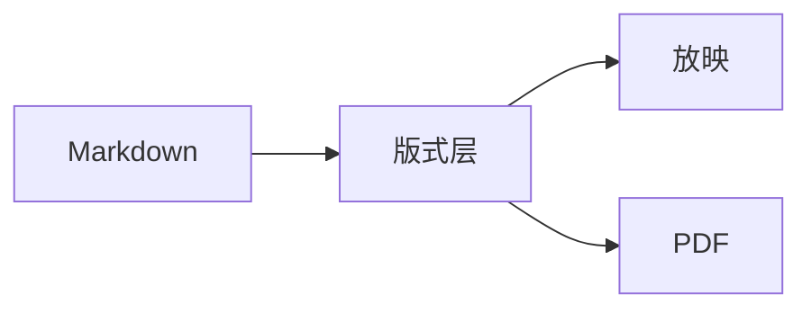

<!-- deck
logo: data:image/svg+xml,%3Csvg xmlns='http://www.w3.org/2000/svg' viewBox='0 0 32 32'%3E%3Ccircle cx='16' cy='16' r='12' fill='none' stroke='%23c44b2b' stroke-width='4'/%3E%3C/svg%3E
brand: ColaMD Extend
title: 幻灯片版式系统
meta: 2026-11 · 内部演示
-->

# 幻灯片版式示例

一篇文档切完 `---` 之后，每一页可以声明一种版式。页头块的第一行是版式，后面可以写 kicker、label、chapter 三个字段；标题后的第一段自动成为导语。这份示例每种版式一页，另外再给两页不写版式的默认文章页——一页示范信息密度，一页收纳表格与代码。放映（⌘⇧P）看效果。

文件顶部那个 `deck` 块是 deck 级公共元素：logo、品牌名、标题、日期。它们印在每页的固定位置，封面和章节页也保留。

---

<!-- slide: cover
kicker: Cover · 主视觉封面
label: 幻灯片版式系统
chapter: 开场
-->

# 幻灯片版式

## 十一种版式，一页一句话

标题放大，副标题压淡，标题后第一段自动成为导语。

---

<!-- slide: agenda
kicker: Agenda · 今日议程
label: 幻灯片版式系统
chapter: Act I · 版式基础
-->

## 今日议程

1. **开胃** 封面与章节
2. **正餐** 数据版式四件套
3. **甜点** 双栏与引言
4. **打包** 收束与行动项

---

<!-- slide: section
kicker: Act I · 数据的讲法
label: 幻灯片版式系统
chapter: Act I · 版式基础
-->

## 第一幕 · 数据的讲法

数字自己会说话，版式只负责给它一个台子。

---

<!-- slide: kpi
kicker: Executive Summary
label: 年度关键数字
chapter: Act I · 数据
-->

## 年度关键数字

决策者一分钟能读完的版本。

- **3.2 亿** 用户规模
- **47%** 年增长率
- **12 项** 行业奖项
- **0 漏洞** 依赖安全

---

<!-- slide: timeline
kicker: History
label: 三年历程
chapter: Act I · 历程
-->

## 三年历程

- **2024** 编辑器内核重写
- **2025** 导出全家桶补齐
- **2026** 版式系统登场

---

<!-- slide: steps
kicker: Process
label: 三步上手
chapter: Act I · 方法
-->

## 三步上手

- **一** 在页首写页头块
- **二** 放映看效果
- **三** 导出成 PDF

---

<!-- slide: matrix
kicker: Details
label: 页内样式微调
chapter: Act I · 微调
-->

## 页内样式微调

- **slide-css** 样式只作用于本页
- **白名单** 拒绝绝对定位与伪协议
- **随主题** 变量照常生效

<!-- slide-css
.cm-md-slide-matrix.cm-md-li {
  background: color-mix(in srgb, var(--pele-accent) 7%, transparent);
  border-color: var(--pele-accent);
}
-->

---

<!-- slide: figure
kicker: Diagram
label: 图表独立页
chapter: Act I · 图表
-->

## 图表独立页

Mermaid、SVG 与普通图片都走这一版式，标题与内容页同档，图占画面约七成并居中。



---

<!-- slide: section
kicker: Motion
label: 会动的章节条
chapter: Act I · 脚本
-->

## 会动的章节条

脚本每 0.7 秒推进一步 CSS 变量，下面的横线就自己长满整页。`slide.setVar` 与 `slide.setClass` 是放映脚本影响页面的仅有的两个出口，脚本本体跑在沙箱 iframe 里，离场即回收。

<!-- slide-css
.cm-md-hr {
  display: block;
  width: calc(var(--slide-demo, 0) * 1%);
  height: 4px;
  font-size: 0;
  color: transparent;
  background: var(--pele-accent);
  margin: 2.5em 0 0;
  border: none;
  transition: width 1.1s ease;
}
-->

<!-- slide-js
[15, 40, 70, 100].forEach(function (w, i) {
  slide.setTimeout(function () { slide.setVar('slide-demo', String(w)); }, 700 * (i + 1));
});
-->

***

<!-- slide: two-col
kicker: Comparison
label: 双栏的用法
chapter: Act II · 对比
-->

## 双栏的用法

左边放论点，右边放论据；或者左右各摆一个方案做对比。栏宽由放映画面决定，导出时退化为两列并排。

## 再来一栏

Markdown 的标题、列表、图表在两栏里各自渲染，`---` 仍然是唯一的分页符。

---

## 默认页：把一页写满

这是没有写 slide 块的默认页：标题收小、行距放宽、行宽收窄，一页能装下更多段落。

默认页把标题收小，正文行距放到 1.8，行宽收到 82%，一页能落下六七百字。版式系统解决的是信息密度，不是装饰。

- **先给结论** 第一段就让读者知道这页要说什么。
- **再拆关系** 并列项用列表，因果链用步骤或时间轴。
- **最后收口** 一页只留一个判断，下一页再展开。

---

## 默认页：表格与代码

内容元素也各有画法：表头走强调色粗线，太长的单元格自动折行；代码块整块折行，不会横向撑破纸面；行内代码压到 0.86em，嵌在句子里不硌眼，比如 `--slide-page-top-pad` 这样的令牌名。

| 版式 | 适合放什么 | 一句话口诀 |
| --- | --- | --- |
| kpi | 关键数字 | 一页只放四个数 |
| timeline | 时间历程 | 按年讲故事 |
| matrix | 对照卡片 | 每行一个判断 |

```css
/* 代码块：长行折行，在导出的纸面上同样安全 */
body.presenting .cm-md-page-start {
  padding-top: var(--slide-page-top-pad);
}
```

---

<!-- slide: quote
kicker: Key Takeaway
label: 核心判断
chapter: Act III · 收束
-->

> 版式是内容的礼服：合身的时候没人注意到它，不合身的时候人人都在议论它。

匿名设计师

---

<!-- slide: closing
kicker: Closing
label: 回家作业
chapter: Act III · 收束
-->

## 回家作业

- 挑一份自己的文档
- 给每页挑一种版式
- 放映一遍，导出一份

---

这就是全部十一种版式；不写 slide 块的页会自动走默认文章版式。自定义主题可以覆盖任何一页的任何细节：版式类名（`cm-md-slide-*`）、页角色（`cm-md-page-title`、`cm-md-page-lead`）与 Markdown 结构（标题、列表、引用）就是全部的约定。
